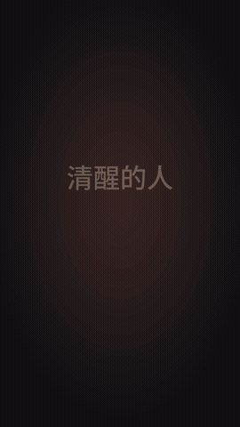

# text2video-styles

> 把一段中文文案，一句话变成 9:16 竖屏文字短视频。
> 一个风格 = 一个 Claude Skill，参数定稿、开箱即用。

对 Claude 说：

```
用极简苹果风把下面的文案生成视频：
如果你做事的动力来自于外在，你永远不会有耐心；
如果你做事的动力来自于内心，那你永远不会有对手！
```

Claude 会自动拆句、渲染、配乐，交付一支 1080×1920 的 mp4。

## 风格一览

| 预览 | 风格 | 说法 | 特点 |
|:---:|---|---|---|
|  | **极简苹果风**<br>`apple-minimal` | 「用极简苹果风……」 | iOS 青蓝渐变背景；逐行 2.5D 玻璃框入场，停留时纯 2D 正对；暖色光带扫过；金色粒子散去后汇聚成完整文案（霞鹜文楷） |
|  | **经典风**<br>`textpower-classic` | 「用文本Power风……」 | 暖棕渐暗背景；一屏一句、按说话节奏断句；关键词彩色大字强调；附带封面 |

更多风格持续加入中，欢迎贡献，见 [新增一个风格](docs/ADD_A_STYLE.md)。

## 安装

### 方式一：Claude Code 插件市场（推荐）

```
/plugin marketplace add thefullhorizon/text2video-styles
/plugin install text2video-styles@text2video-styles
```

### 方式二：手动安装单个风格

```bash
git clone https://github.com/<你的GitHub用户名>/text2video-styles.git
cp -r text2video-styles/plugins/text2video-styles/skills/apple-minimal ~/.claude/skills/
```

### 运行依赖

| 依赖 | 用途 | 安装 |
|---|---|---|
| Python 3.9+ | 渲染脚本 | — |
| Playwright + Chromium | 极简苹果风逐帧渲染 | `pip install playwright && playwright install chromium` |
| Pillow、numpy | 经典风 | `pip install pillow numpy` |
| ffmpeg | 合成视频与配乐 | `brew install ffmpeg` |
| 思源黑体 Noto Sans CJK | 正文字体 | `brew install --cask font-noto-sans-cjk` |
| 霞鹜文楷 | 极简苹果风结尾字体 | 在 `apple-minimal/` 目录执行 `npm install` |

## 不用 Claude，直接命令行出片

```bash
cd plugins/text2video-styles/skills/apple-minimal
npm install
python3 make_video.py ../../../../examples/apple-minimal.json out.mp4
```

## 目录结构

```
text2video-styles/
├── .claude-plugin/marketplace.json     # 插件市场清单
├── plugins/text2video-styles/
│   ├── .claude-plugin/plugin.json
│   └── skills/
│       ├── apple-minimal/              # 极简苹果风
│       └── textpower-classic/          # 经典风
├── examples/                           # 各风格的示例文案 spec.json
├── scripts/                            # 素材生成脚本
└── docs/                               # 预览图、贡献指南
```

## 授权

- 代码：MIT，见 [LICENSE](LICENSE)
- 字体：霞鹜文楷、思源黑体均为 SIL OFL 1.1，不随仓库分发
- **配乐 `starlight.m4a` 非原创，版权归原作者所有，仅作演示；商用前请替换为你有授权的音乐。** 详见 [NOTICE.md](NOTICE.md)

## 作者

Taylor · [X @Taylor_AIPM](https://x.com/Taylor_AIPM) · 由「文本Power」项目孵化
